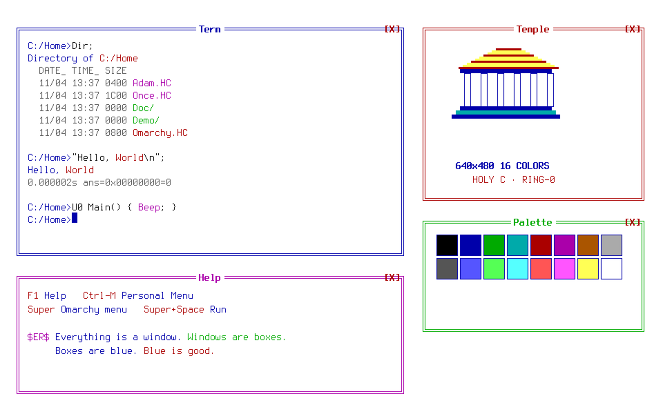

# Omarchy TempleOS Theme

Тема для [Omarchy](https://omarchy.org) в духе **TempleOS** Терри Дэвиса: синий фон `#0000aa`,
16-цветная DOS-палитра, квадратные окна с толстой синей рамкой, без блюра, теней и анимаций.
«Everything is a window. Windows are boxes. Boxes are blue. Blue is good.»



## Что внутри

| Файл | Назначение |
|------|-----------|
| `colors.toml` | 16-цветная палитра (omarchy-shell, терминал, borders) |
| `shell.toml` | бар и меню в стиле DOS: синяя полоса сверху, белая карточка меню, инверсия выбранной строки |
| `hyprland.lua` | квадратные окна, рамка 3px `#0000aa`, нулевое скругление, всё без анимаций |
| `icons.theme` | Yaru-blue |
| `backgrounds/` | 5 обоев: рабочий стол, минимал, debug, слон, «весы» |

## Установка

```bash
git clone https://github.com/Ratmanchik729/omarchy-templeos.git
cp -r omarchy-templeos ~/.config/omarchy/themes/templeos
rm -rf ~/.config/omarchy/themes/templeos/.git
```

Затем `Super + Space` → Theme (или `omarchy-theme-menu`) и выбери **templeos**.

## Лицензия

MIT — см. [LICENSE](LICENSE). TempleOS создан Терри А. Дэвисом; это уважительная
стилизация рабочего окружения, не связана с оригинальной ОС.
